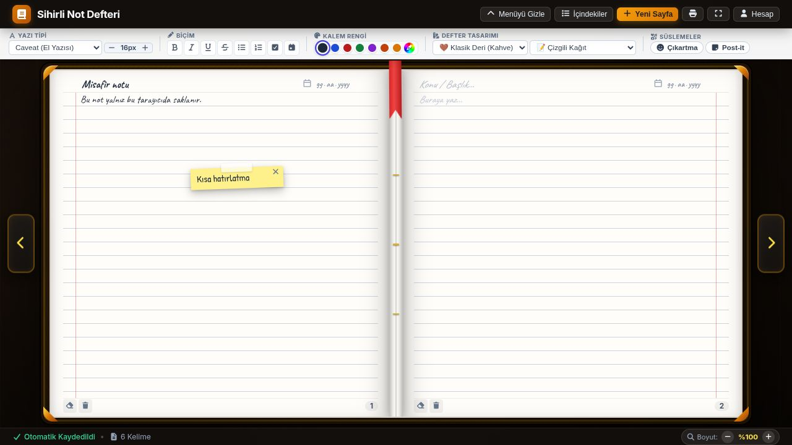
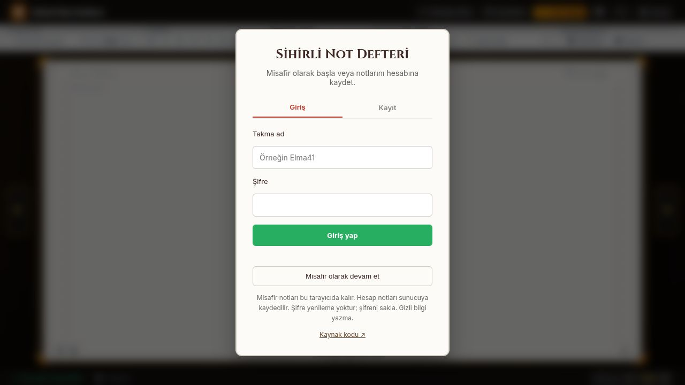

# Sihirli Not Defteri

İki sayfalı defter görünümünde not yazma, sayfa çevirme, çıkartma ve renkli post-it ekleme uygulaması. Yazı tipi, kapak ve kâğıt teması seçilebilir; notlar tarayıcının yazdırma ekranından PDF olarak kaydedilebilir.

[📖 Webde kullan](https://defter.muhammet-tekin.dev) · [Kurulum](#yerelde-çalıştırma) · [Güvenlik ve veri](#güvenlik-ve-veri)

Eski [önizleme adresi](https://notebook-preview.92-5-36-162.sslip.io) de çalışır. Aynı uygulama ve hesapları kullanır; tarayıcı oturumları ve misafir notları alan adına özeldir.

## Ekran görüntüleri

Misafir notlarıyla defter görünümü ve hesap ekranı:






## Kullanım

- **Misafir:** Hesap açmadan çalışır. Notlar yalnız kullandığınız tarayıcıda kalır; tarayıcı verilerini silmek notları da siler.
- **Hesap:** Bir takma ad ve en az 8 karakterli şifreyle kayıt olun. Notlar hesabınıza özel SQLite kaydında saklanır. Paylaşılan cihazda çıkış yapın.
- Her defter en fazla **120 sayfa ve 1 MB** olabilir. Her sayfada en fazla 50 çıkartma/post-it bulunur.
- Hesap panelinden çıkış yapabilir veya hesabınızı ve sunucudaki notlarınızı silebilirsiniz.
- Şifre yenileme özelliği yoktur. Şifrenizi saklayın. Herkese açık örnek yayına gizli veya hassas bilgi yazmayın; PDF ile kendi kopyanızı alın.

## Yerelde çalıştırma

Node.js 22 veya üzeri gerekir; CI ve konteyner Node.js 24 kullanır.

```bash
npm ci
npm start
```

Tarayıcıda `http://127.0.0.1:3005` adresini açın. Sunucu hem arayüzü hem API'yi sunar. Varsayılan dinleyici yalnız `127.0.0.1` üzerindedir. Geliştirmede JWT anahtarı verilmezse geçici bir anahtar üretilir.

```bash
npm test
npm audit --omit=dev
```

Testler geçici veritabanları kullanır; gerçek `database.sqlite` dosyasına dokunmaz.

## Üretim

`NODE_ENV=production`, en az 32 karakterlik rastgele `JWT_SECRET` ve HTTPS `PUBLIC_ORIGIN` zorunludur. Anahtarları Git'e eklemeyin. `DATABASE_PATH` ile kalıcı veritabanı konumunu seçin; HTTPS sağlayan bir proxy arkasında çalıştırın.

`deploy/Dockerfile` ve `deploy/compose.yml`, bu portföy yayını için ayrı servis ve veri dizini kullanır. Konteyner kök kullanıcıyla çalışmaz; dosya sistemi salt okunur, kaynakları sınırlıdır ve dışarıya port açmaz. Caddy yalnız özel Unix soketine bağlanır. Compose dosyasındaki alan adı ve host dizinlerini kendi kurulumunuza göre değiştirin.

`TRUST_PROXY=unix` yalnız dışarıdan erişilemeyen Unix soketi ve istemci IP başlığını yeniden yazan güvenilir proxy ile kullanılmalıdır. Genel ağda bu ayarı kullanmayın.

## Güvenlik ve veri

- Tuzlu, asenkron scrypt parola özeti; eski SHA-256 kayıtları başarılı girişte yükseltilir.
- Tarayıcı oturumu HttpOnly/Secure/SameSite cookie ile taşınır ve 7 gün sonra sona erer. Tarayıcıda token localStorage'a yazılmaz. Bearer token API istemcileri için desteklenir.
- Hesap kayıt/giriş denemeleri ve genel API istekleri sınırlıdır; kayıt kapasitesi yapılandırılabilir.
- Not HTML'i sunucuda ve tarayıcıda temizlenir. Çapraz site istekleri engellenir; kaynak kodu ve veritabanı web üzerinden sunulmaz.
- Hesaplar ayrı yerel önbellekler kullanır. Çıkışta mevcut hesabın yerel not kopyası kaldırılır.
- Operatör, veri yedekleme ve saklama politikasını kendi kurulumunda belirlemelidir. Portföy yayınında günlük yedekler 7 gün tutulur; silinen hesap eski yedeklerde bu süre boyunca kalabilir.
- Notlar uçtan uca şifreli değildir; sunucu operatörü veritabanına erişebilir.

Bu kontroller tüm açıkların giderildiği garantisi değildir. Sorun bildirmek için kişisel not, parola veya token paylaşmadan GitHub issue açın.

DOMPurify ve Font Awesome dosyaları `vendor/` altında lisanslarıyla birlikte sunulur. Yazı tipleri Google Fonts üzerinden yüklenir; bağlantı kurulamazsa sistem yazı tipi kullanılır. Node.js, Express, SQLite, vanilla JavaScript ve CSS kullanılır.
